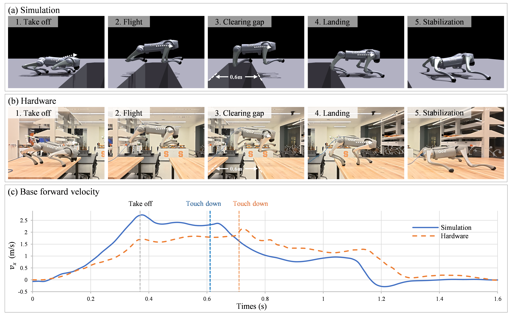

# VMC-Guided Curriculum Learning for Dynamic Quadrupedal Jumping
# VMCCurriculum
## Video


## Overview

This file documents the policy train for a quadrupedal called go2 from Unitree with Jumping.

Introduction:

This paper presents a virtual model control (VMC)-guided curriculum that uses temporary mechanical assistance to facilitate this exploration.

Contents:


This is research code, expect that it changes often and any fitness for a particular purpose is disclaimed.

The source code is released under a [BSD 3-Clause license](LICENSE).

**Author: Jing Cheng, Xulin Chen, Yasser G. Alqaham, Jun Zhou, Garrett E. Katz, and Zhenyu Gan<br />
Affiliation: [DLAR Lab](https://dlarlab.syr.edu)<br />
Maintainer: Jing Cheng, jcheng13@syr.edu />**
With contributions by: Unitree(https://github.com/unitreerobotics/unitree_guide)

This project was initially developed at Syracuse University (Dynamic Locomotion and Robotics Lab).


## Publications

This work has been submitted to the American control conference (ACC 2027).

If you use this work in an academic context, please cite the following publication:

## Requirements
### Environment and Installation
```bash
conda create -n VMCGuided python=3.8
conda activate RLjumping
pip3 install torch==1.10.0+cu113 torchvision==0.11.1+cu113 torchaudio==0.10.0+cu113 -f https://download.pytorch.org/whl/cu113/torch_stable.html
git clone git@github.com:DLARlab/VMCCurriculum.git
# Download the Isaac Gym binaries from https://developer.nvidia.com/isaac-gym 
# Trained with Preview 4
cd isaacgym/python && pip install -e .
cd ~/VMCCurriculum/rsl_rl && pip install -e .
cd ~/VMCCurriculum/legged_gym && pip install -e .
cd ~/VMCCurriculum && pip install -r requirements.txt
```

### Dependencies

Please place the three packages, unitree_guide, unitree_ros, and unitree_ros_to_real in our repository in a ROS workspace’s source directory.

## build

Open a terminal and switch the directory to the ros workspace containing unitree_guide, then run the following command to build the project:
```
catkin_make
```

## run

In the same terminal, run the following command step by step:
```
source ./devel/setup.bash
```
To open the gazebo simulator, run:
```
roslaunch unitree_guide gazeboSim.launch 
```

For starting the controller, open an another terminal and switch to the same directory,  then run the following command:
```
./devel/lib/unitree_guide/junior_ctrl
```


## Training
1. To train an upwards jumping policy simply run:
```
cd ~/VMCCurriculum/legged_gym/scripts
WANDB_MODE=online WANDB_PROJECT=curri_jumping python train.py --max_iterations 6000 --task go2_gap --headless

2. Then use the the follow code verify the result 
python play_go2.py --task go2_gap --load_run RUN_ID


## Acknowledgments

This code base builds on the following works:

- [legged_gym](https://github.com/leggedrobotics/legged_gym) — Legged Robotics, ETH Zurich
- [walk-these-ways-go2](https://github.com/Teddy-Liao/walk-these-ways-go2) — Teddy Liao
- [Curriculum-Quadruped-Jumping-DRL](https://github.com/vassil-atn/Curriculum-Quadruped-Jumping-DRL) — Vassil Atanassov

Special thanks to Vassil Atanassov for the online guide that helped me get this
project running.
```
